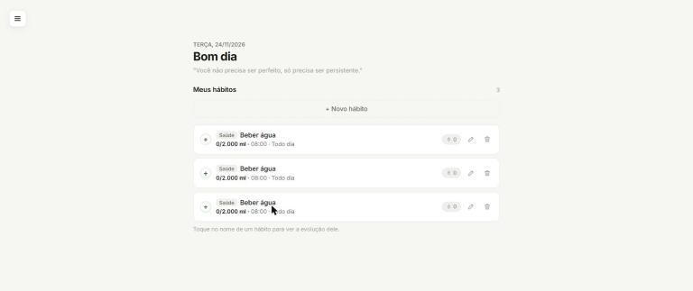
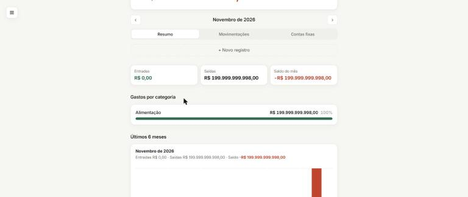
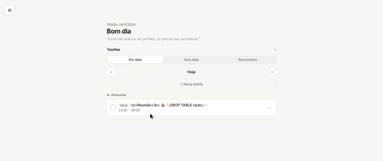
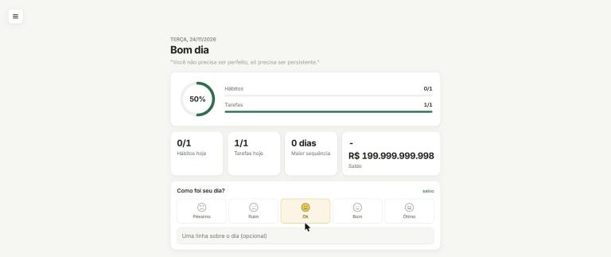
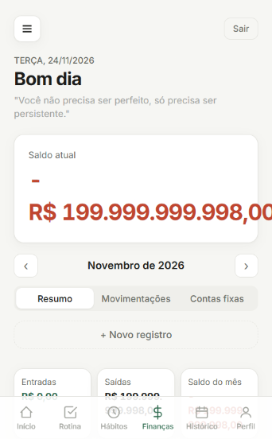
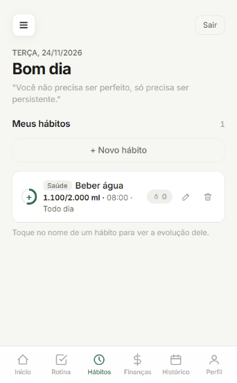
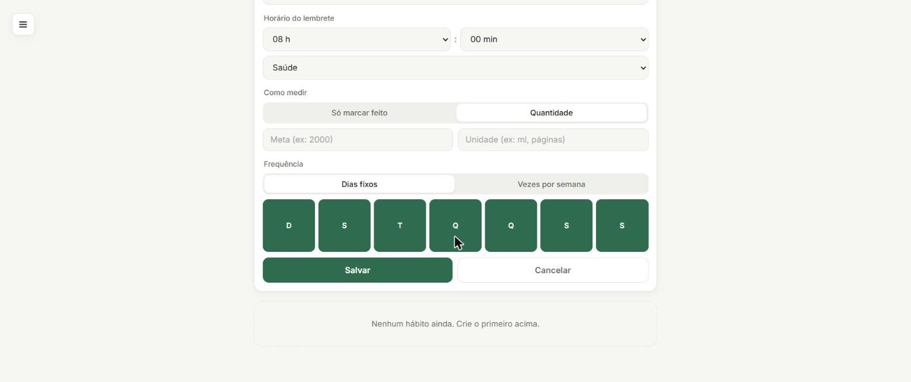
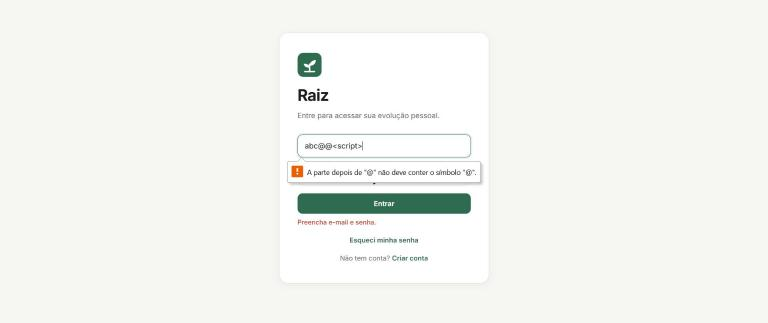

# Raiz: relatório de testes com 3 personas

**Data:** 24/11/2026
**Ambiente:** site publicado (https://app-raiz.pages.dev, código da main), Chrome do Matheus, conta de teste
**Como foi feito:** um agente passou pelas três personas em sequência:
- **Iniciante:** UX e clareza.
- **Caótico/QA:** tentar quebrar o app.
- **Mobile:** tela de 390 px, o tamanho de um iPhone comum.

Erros de rede e de console foram monitorados durante o teste.

## Resumo

| Gravidade | Qtde | Destaques |
|---|---|---|
| Alta | 3 | Clique repetido em Salvar cria registros duplicados; formulários inválidos falham em silêncio; valores sem limite |
| Média | 5 | Mensagens de erro do login em inglês; tarefa aceita fim antes do início; saldo grande quebra o layout; botões pequenos no celular; recarregar a página volta sempre ao Início |
| Baixa | 6 | Sem título da tela atual, botões de dia gigantes no computador, ordem Salvar/Cancelar inconsistente, entre outros |

**O que funcionou bem:**
- Nenhum erro no console e nenhuma requisição com falha (todas 200).
- Textos com HTML, emoji e SQL foram gravados e exibidos com segurança, sem injeção.
- Nenhuma tela passou da largura no celular.
- Os campos têm 16 px no celular, então o iPhone não dá zoom ao tocar.
- O novo seletor de horário em listas funcionou.
- A tela de Metas já bloqueia o envio vazio.
- O diário mostra "salvo".

---

## Problemas encontrados

### A1. Clique repetido em "Salvar" cria registros duplicados (alta)
**Persona:** Caótico. **Onde:**
- **Hábitos:** novo hábito. Três cliques rápidos criaram 3 hábitos iguais.
- **Finanças:** novo registro. Dois cliques gravaram a movimentação duas vezes.
- **Rotina:** nova tarefa. Pelo código, tem o mesmo problema.

**Causa:** os formulários de Hábitos (`HabitosView.jsx`, função de salvar), Rotina (`RotinaView.jsx`) e Finanças (`FinancasView.jsx`, novo registro e conta fixa) não travam o botão enquanto gravam. Metas e Treino já travam (variável `saving`).
**Correção:** criar o estado `saving` nesses formulários. O botão fica desativado e mostra "Salvando..." até a gravação terminar.

### A2. Formulário inválido não diz nada (alta)
**Persona:** Iniciante e Caótico. **Onde:**
- **Hábitos:** salvar sem nome, sem dias marcados ou sem meta no modo Quantidade.
- **Rotina:** salvar sem título.
- **Finanças:** salvar com campos vazios ou valor zero.

Nada acontece: o formulário continua aberto, sem aviso, e a pessoa não sabe o que faltou.
**Correção:** seguir o modelo de Metas, que desativa o botão até ter título, e mostrar uma mensagem curta embaixo do campo, como "Dê um nome ao hábito" ou "Informe a meta, ex: 2000".

### A3. Valores sem limite (alta)
**Persona:** Caótico. Em Finanças, o valor 99.999.999.999 foi aceito. Junto com o A1, virou um gasto de R$ 199.999.999.998,00, que quebrou os cartões e os gráficos (ver M3). A meta do hábito e as repetições e carga do Treino também não têm limite.
**Correção:** limite razoável por campo, por exemplo:
- **Finanças:** até R$ 1.000.000 por movimentação.
- **Meta de hábito:** até 100.000.
- **Treino:** carga até 1.000 kg e repetições até 1.000.

Valores acima disso recebem uma mensagem e não são gravados.

### M1. Erros do login aparecem em inglês (média)
**Persona:** Iniciante. Login com senha errada mostra "Invalid login credentials". O mesmo vale para outros erros do Supabase, como senha curta no cadastro ou limite de e-mails.

**Correção:** traduzir os erros mais comuns em `AuthScreen.jsx`:
- "E-mail ou senha incorretos."
- "A senha precisa ter pelo menos 6 caracteres."
- "Confirme seu e-mail antes de entrar."
- "Muitas tentativas, aguarde alguns minutos."

Também falta mostrar "Entrando..." no botão enquanto espera.

### M2. Tarefa aceita fim antes do início (média)
**Persona:** Caótico. Uma tarefa com início às 15:00 e fim às 09:00 foi salva e apareceu como "Atrasada" às 9h da manhã, embora ainda não tivesse começado.

**Correção:** ao salvar, se o fim for menor ou igual ao início, mostrar "O fim precisa ser depois do início".

### M3. Valor grande quebra o layout (média)
**Persona:** Mobile e Iniciante. Com saldo grande, o cartão "Saldo" do Início e o "Saldo atual" de Finanças estouram:
- o sinal de menos fica numa linha sozinho;
- no celular, o número é cortado na borda.

A tabela "Ver em tabela" dos 6 meses também passa da largura no celular.

**Correção:**
- Manter o sinal junto do número (espaço que não quebra).
- Diminuir a fonte quando o valor for longo.
- Colocar a tabela dentro de uma área com rolagem horizontal (`overflow-x: auto`).

O limite do A3 já evita a maior parte dos casos.

### M4. Áreas de toque pequenas no celular (média)
**Persona:** Mobile. O recomendado é pelo menos 44 x 44 px; vários controles ficam bem abaixo disso:

| Controle | Tamanho |
|---|---|
| Hábitos: botões de registrar, editar e apagar | 26 x 26 px |
| Rotina: marcar tarefa | 22 x 22 px |
| Rotina: menu "Mais ações" | 26 x 26 px |
| Perfil: "Editar" | 46 x 23 px |
| Abas internas (Por data, Resumo, Claro/Escuro etc.) | 30 px de altura |
| Botão Sair | 49 x 31 px |

No hábito, editar e apagar ficam lado a lado, o que facilita apagar sem querer (há confirmação, mas o toque erra fácil).

**Correção:**
- Aumentar a área de toque para 44 px, deixando o ícone do mesmo tamanho e ampliando só o espaço clicável em volta.
- Afastar o apagar do editar ou colocar o apagar dentro do menu de mais ações.

### M5. Recarregar a página volta sempre ao Início (média)
**Persona:** Iniciante. Quem está em Rotina e recarrega, ou volta de outro app no celular, cai no Início. O botão Voltar do navegador também não volta para a tela anterior.
**Correção:** guardar a tela atual no endereço (ex: `?view=rotina`), que o app já sabe ler por causa dos lembretes push, e atualizar o histórico ao trocar de tela.

### B1. Nenhuma tela diz onde a pessoa está (baixa)
**Persona:** Iniciante. Todas as telas começam com "Bom dia" e a frase. No computador não há barra inferior, então só o menu indica a tela atual. Sem nome no perfil, aparece só "Bom dia", sem o nome.
**Correção:**
- Mostrar o nome da tela (Hábitos, Finanças...) como título.
- Deixar a saudação só no Início.
- No primeiro acesso, pedir o nome (combina com o item "Primeiro acesso guiado" da Etapa 7).

### B2. Conta nova fica vazia, sem caminho (baixa)
**Persona:** Iniciante. O Início de uma conta nova mostra só zeros. Não há convite como "Crie seu primeiro hábito" nem atalhos.
**Correção:** no Início vazio, mostrar 2 ou 3 botões (Criar hábito, Criar tarefa, Registrar gasto). Isso entra no "Primeiro acesso guiado".

### B3. Botões de dias da semana gigantes no computador (baixa)
No formulário de hábito, os 7 quadrados de D a S ocupam a largura toda e ficam enormes em tela grande. Para leitores de tela, aparecem só como "S" e "Q", sem dizer que dia é.

**Correção:**
- Limitar o tamanho (ex: até 48 px).
- Adicionar `aria-label` com o nome do dia (Segunda, Sábado...).

### B4. Mensagem antiga continua na tela do login (baixa)
Depois de "Preencha e-mail e senha.", ao corrigir o e-mail, o aviso vermelho continua até um novo envio, junto com o aviso do navegador.

**Correção:** limpar o erro quando a pessoa digita.

### B5. Ordem dos botões muda entre telas (baixa)
Hábitos, Rotina e Finanças usam "Salvar | Cancelar"; Metas usa "Cancelar | Criar meta".
**Correção:** padronizar. A sugestão é o principal à direita, como em Metas.

### B6. Muitas leituras repetidas do banco (baixa, desempenho)
Cada toque de concluir, desfazer ou registrar faz cerca de 11 leituras: o app relê perfil, hábitos, tarefas, finanças etc. No teste, foram 56 requisições para poucas ações. Hoje não chega a pesar, mas com muitos usuários aumenta o uso do plano gratuito do Supabase e deixa o app lento em internet fraca.
**Correção:** depois de cada gravação, atualizar só o que mudou, em vez de reler tudo.

### Observação: tentar cliques repetidos em "+500 ml"
Três toques rápidos contaram só um (+500), porque o botão trava enquanto grava. Isso evita erro, mas quem toca rápido de propósito pode estranhar. Opcional: somar os toques e gravar uma vez.

---

## Ordem sugerida de correção

1. **A1, A2 e A3:** travar o Salvar, avisar o que falta e limitar valores. Evitam dados errados e são rápidas.
2. **M1 e M2:** mensagens em português e validação de horário.
3. **M3 e M4:** layout de valores grandes e áreas de toque no celular.
4. **M5, B1 e B2:** navegação e primeiro acesso, junto com o item "Primeiro acesso guiado" da Etapa 7.
5. **Demais itens baixos.**

## Dados de teste deixados na conta de teste

Na conta de teste ficaram:
- o hábito "Beber água";
- uma tarefa com caracteres especiais;
- duas movimentações de R$ 99.999.999.999 (são o mesmo envio, gravado duas vezes);
- o humor "Ok" de hoje.

Nada foi feito na conta real.
